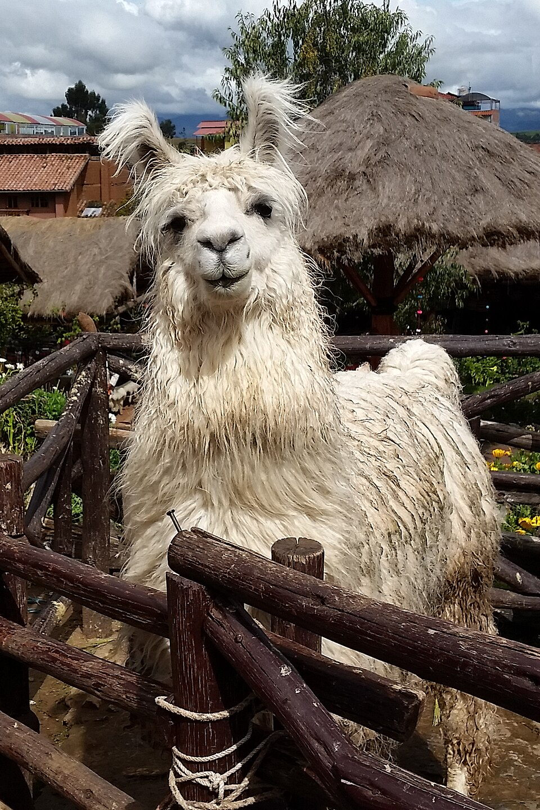

## The models: LLaMA and Vicuna

:::: {.columns}
::: {.column width="38%"}
{height=2in fig-align="center"}

\centering LLaMA-13B (Meta, 2023)
:::
::: {.column width="62%"}
{height=2in fig-align="center"}

\centering Vicuna-13B (LMSYS, 2023)
:::
::::

\vfill
\scriptsize Photos: PA (llama) and Marshallhenrie (vicuña), Wikimedia Commons, [CC BY-SA 4.0](https://creativecommons.org/licenses/by-sa/4.0/)

## Why "LLaMA" and "Vicuna"?

Where do the names come from?

. . .

**LLaMA** is a backronym: **L**arge **La**nguage **M**odel Meta **A**I

**Vicuna** is a fine-tuned LLaMA from LMSYS, named after a relative of the llama:

```{=latex}
\begin{itemize}\setlength{\itemsep}{2pt}\setlength{\parskip}{0pt}
  \item Llama $\to$ Meta's base model
  \item Alpaca $\to$ Stanford's fine-tune
  \item Vicuna $\to$ LMSYS's fine-tune, trained on ShareGPT conversations
\end{itemize}
```

\small The vicuña is believed to be the ancestor of the domesticated alpaca.

## The history of LLaMA (2023–2026)

```{=latex}
\centering
\begin{tikzpicture}[font=\footnotesize,
    ev/.style={anchor=north west, text width=0.8\textwidth, inner sep=2pt},
    dt/.style={anchor=east, inner sep=2pt},
    dot/.style={circle, fill, inner sep=0pt, minimum size=4.5pt}]

  % events, each placed just below the previous one
  \node[ev] (e1) at (0,0) {LLaMA released to researchers; weights leak via BitTorrent~\cite{meta2023llama}};
  \node[ev] (e2) at ([yshift=-4pt]e1.south west) {Vicuna: LMSYS fine-tunes LLaMA on ShareGPT conversations};
  \node[ev, text=blue!70!black, font=\footnotesize\bfseries\boldmath] (e3) at ([yshift=-4pt]e2.south west) {MT-Bench and Chatbot Arena \enspace$\longleftarrow$ Zheng et al.~\cite{zheng2023judging}};
  \node[ev] (e4) at ([yshift=-4pt]e3.south west) {LLaMA 2~\cite{meta2023llama2}};
  \node[ev] (e5) at ([yshift=-4pt]e4.south west) {LLaMA 3~\cite{meta2024llama3}};
  \node[ev] (e6) at ([yshift=-4pt]e5.south west) {LLaMA 4~\cite{meta2025llama4}};
  \node[ev] (e7) at ([yshift=-4pt]e6.south west) {\textbf{Muse Spark}~\cite{meta2026musespark}};
  \node[ev] (e8) at ([yshift=-4pt]e7.south west) {\textbf{Muse Glimmer:} open weights, pitched for ``LLM-as-a-judge''~\cite{meta2026museglimmer}};
  \node[ev] (e9) at ([yshift=-4pt]e8.south west) {\textbf{Muse Spark Open}~\cite{meta2026musesparkopen}};

  % spine
  \draw[gray!50, thick] ([xshift=-0.35cm, yshift=0.5ex]e1.base west)
                     -- ([xshift=-0.35cm, yshift=0.5ex]e9.base west);

  % dots and dates for ordinary rows
  \foreach \i/\d/\c in {1/Feb 2023/black, 2/Mar 2023/black, 4/Jul 2023/black,
                        5/Apr 2024/black, 6/Apr 2025/black,
                        7/Apr 2026/black, 8/Aug 2026/black, 9/Oct 2026/red!70!black} {
    \node[dot, \c] at ([xshift=-0.35cm, yshift=0.5ex]e\i.base west) {};
    \node[anchor=base east, inner sep=2pt, text=\c] at ([xshift=-0.6cm]e\i.base west) {\d};
  }

  % the highlighted row
  \node[dot, blue!70!black, minimum size=6pt] at ([xshift=-0.35cm, yshift=0.5ex]e3.base west) {};
  \node[anchor=base east, inner sep=2pt, text=blue!70!black, font=\footnotesize\bfseries] at ([xshift=-0.6cm]e3.base west) {Jun 2023};

\end{tikzpicture}
```


## Example 1:

:::: {.columns}
::: {.column width="50%"}
```{=latex}
\begin{tcolorbox}[colback=gray!6, colframe=gray!45, boxrule=0.4pt, arc=2mm,
  left=5pt, right=5pt, top=3pt, bottom=4pt,
  title={\sffamily Question}, fonttitle=\scriptsize\bfseries,
  coltitle=black, colbacktitle=gray!18]
\ttfamily\scriptsize\raggedright
If the FED buys bonds in the secondary market\\[0.3em]
\textbf<3>{(A) the money supply will increase.}\\
(B) the money supply will decrease.\\
(C) the money supply will not be affected.\\
(D) the discount rate would be affected.\\[0.5em]
Output the answer only.
\end{tcolorbox}
```
:::
::: {.column width="50%"}
```{=latex}
\visible<2->{%
\begin{tikzpicture}[scale=0.85, >=stealth, font=\scriptsize]
  \useasboundingbox (-0.7,-0.7) rectangle (5.6,4.3);

  \draw[->] (0,0) -- (5,0) node[below left=2pt] {Quantity of money};
  \draw[->] (0,0) -- (0,4) node[above] {Interest rate};

  \draw[thick, domain=0.8:4.6, smooth] plot (\x, {3/\x}) node[right] {$MD$};

  % original supply: solid on slide 2, faded on slide 3
  \only<2>{\draw[very thick, blue] (2,0) -- (2,3.6) node[above] {$MS_1$};}
  \only<3>{\draw[thick, blue!35, dashed] (2,0) -- (2,3.6) node[above] {$MS_1$};}
  \draw[dotted] (0,1.5) node[left] {$i_1$} -- (2,1.5);
  \fill (2,1.5) circle (1.6pt);

  \only<3>{
    \draw[very thick, red] (3,0) -- (3,3.6) node[above] {$MS_2$};
    \draw[->, thick] (2.1,2.8) -- (2.9,2.8);
    \draw[dotted] (0,1) node[left] {$i_2$} -- (3,1);
    \fill[red] (3,1) circle (1.6pt);
  }
\end{tikzpicture}%
}
```
:::
::::

## How did they do?

:::: {.columns}
::: {.column width="48%"}
```{=latex}
\begin{chatbox}[colback=blue!5, equal height group=answers]{LLaMA-13B}
The Federal Reserve buys bonds in the secondary market to increase
the money supply.
\end{chatbox}
```
:::
::: {.column width="48%"}
```{=latex}
\begin{chatbox}[colback=blue!5, equal height group=answers]{Vicuna-13B}
(A) the money supply will increase.
\end{chatbox}
```
:::
::::

\vspace{0.6em}
\onslide<2->{\textbf{Both are factually correct.} But...}

\vspace{0.3em}
\onslide<3->{The prompt said to ``output the answer only.''

\begin{itemize}\setlength{\itemsep}{2pt}\setlength{\parskip}{0pt}
  \item LLaMA provided its own answer. 
  \item Vicuna outputted the correct answer verbatim from the four options listed. 
\end{itemize}
\vspace{0.3em}
}

## Example 1 - Follow-up:

```{=latex}
\begin{tcolorbox}[colback=gray!6, colframe=gray!45, boxrule=0.4pt, arc=2mm,
  left=5pt, right=5pt, top=3pt, bottom=4pt,
  title={\sffamily Follow-up Question}, fonttitle=\scriptsize\bfseries,
  coltitle=black, colbacktitle=gray!18]
\ttfamily\scriptsize\raggedright
How does it affect my daily life? Give 3 examples
\end{tcolorbox}
\vspace{-0.6em}
\onslide<2->{%
\begin{columns}[T]
\begin{column}{0.32\textwidth}
\begin{chatbox}[colback=blue!5, equal height group=followup, fontupper=\ttfamily\fontsize{7}{8.4}\selectfont\raggedright]{LLaMA-13B}
The Federal Reserve buys bonds in the secondary market to increase the
money supply. This affects your daily life by:\\[0.3em]
1. Increasing the money supply.\\
2. Increasing the money supply and lowering the discount rate.\\
3. Increasing the money supply and lowering the discount rate and
increasing the money supply.
\end{chatbox}
\end{column}
\begin{column}{0.66\textwidth}
\begin{chatbox}[colback=blue!5, equal height group=followup, fontupper=\ttfamily\fontsize{7}{8.4}\selectfont\raggedright]{Vicuna-13B}
When the Federal Reserve buys bonds in the secondary market, it can have
several effects on the economy that can impact your daily life. Here are
three examples:\\[0.3em]
1. Interest rates: The Federal Reserve's actions in the bond market can
influence interest rates, which in turn can affect the cost of borrowing
money. For example, if the Federal Reserve buys bonds and drives up demand
for them, interest rates on things like mortgages, car loans, and credit
cards may go up, making it more expensive to borrow money.\\
2. Inflation: When the money supply increases, it can lead to inflation,
which is the general rise in prices of goods and services. This can impact
your daily life by making it more expensive to buy things like groceries,
gas, and other necessities.\\
3. Employment: The Federal Reserve's actions in the bond market can also
have an impact on employment. For example, if the Federal Reserve's
actions lead to economic growth and increased demand for goods and
services, it can create more job opportunities and boost employment.
\end{chatbox}
\end{column}
\end{columns}}
```

## Example 1 - GPT-4 as judge

```{=latex}
\begin{chatbox}[colback=green!4, colframe=green!30!gray]{GPT-4 Judgment}
LLaMA-13B provided an incorrect response to the user's question about how
the Federal Reserve buying bonds in the secondary market affects daily life.
The answer given is repetitive and lacks clear examples of how the action
impacts daily life.\\[0.4em]
On the other hand, Vicuna-13B provided a relevant and accurate response to
the user's question about the Federal Reserve buying bonds. The answer
includes three clear examples of how the action impacts daily life, such as
interest rates, inflation, and employment.\\[0.4em]
LLaMA-13B should improve by providing relevant, clear, and accurate examples
to address the user's question. \textbf{Vicuna-13B's response is more helpful,
relevant, and detailed.}
\end{chatbox}
\vspace{0.4em}
\onslide<2->{\textbf{Vicuna more helpful, relevant, and detailed}
\begin{itemize}\setlength{\itemsep}{2pt}\setlength{\parskip}{0pt}
  \item LLaMA: repetitive, no real examples
  \item Vicuna: three clear, accurate examples
\end{itemize}}
```

## Scores under different benchmarks

Example 1 is an MMLU question.

```{=latex}
\begin{center}
\begin{tabular}{lcc}
\toprule
Model & MMLU (5-shot) & MT-Bench score (GPT-4) \\
\midrule
LLaMA-13B  & 47.0 & 2.61 \\
Vicuna-13B & 52.1 & 6.39 \\
\bottomrule
\end{tabular}

\vspace{-0.4em}
{\scriptsize Table 8 in the paper. MT-Bench is scored 1--10 by GPT-4.}
\end{center}
```

. . .

```{=latex}
\begin{itemize}\setlength{\itemsep}{2pt}\setlength{\parskip}{0pt}
  \item On MMLU: a 5-point gap
  \item On human-style preference: Vicuna scores $2.4\times$ higher
\end{itemize}
```

**These benchmarks were designed to measure knowledge, not human preferences.**

## Key terms

```{=latex}
\begin{description}\setlength{\itemsep}{3pt}\setlength{\parskip}{0pt}
  \item[Base model] Pre-trained on raw text to predict the next token (LLaMA)
  \item[Instruction fine-tuning] Further training on (instruction, response) pairs so it follows directions (Vicuna)
  \item[RLHF] Reinforcement learning from human feedback: humans rank outputs, the model is tuned toward the winners (GPT-4, Claude)
  \item[Aligned model] A base model after either of the above
\end{description}
```

. . .

Users strongly prefer aligned models, but *measuring* that is not straightforward.

## Human ratings

Human rating is the gold standard for judging a chatbot.

. . .

However, collecting such data is slow and expensive:

```{=latex}
\begin{itemize}\setlength{\itemsep}{2pt}\setlength{\parskip}{0pt}
  \item Every new model, prompt, and version needs fresh ratings
  \item Open-ended answers lack a reference solution to check against
  \item Similarity metrics like BLEU and ROUGE require a reference solution
\end{itemize}
```

. . .

\vspace{0.4em}
**Research question:** can a ``strong'' LLM stand in for the human raters?

## LLM-as-a-judge

```{=latex}
\begin{itemize}\setlength{\itemsep}{2pt}\setlength{\parskip}{0pt}
\item Use a ``strong'' LLM as a surrogate for human raters. 
\item Show it a question and one or more chatbot answers, and ask it to grade them.
\end{itemize}
```

. . .

Models like GPT-4 are themselves trained with RLHF, so they already encode human preferences.

. . .

Check for:

```{=latex}
\begin{enumerate}\setlength{\itemsep}{2pt}\setlength{\parskip}{0pt}
  \item What \textbf{biases} does the judge have, and how can we mitigate them? (Section 3)
  \item Does the judge \textbf{agree with humans}? (Section 4)
\end{enumerate}
```

## Paper's contribution

```{=latex}
\begin{enumerate}\setlength{\itemsep}{4pt}
  \item Studies LLM judges directly, including prompting, LLM biases, and how to mitigate some of them
  \item Two human-preference datasets to validate against:
    \begin{itemize}
      \item \textbf{MT-Bench}: 80 multi-turn questions, 3K expert votes
      \item \textbf{Chatbot Arena}: crowdsourced anonymous battles, 30K conversations
    \end{itemize}
  \item Main result: GPT-4 agrees with humans over \textbf{80\%} of the time, the same rate humans agree with each other
\end{enumerate}
```

## Outline

```{=latex}
\begin{enumerate}\setlength{\itemsep}{3pt}
  \item Introduction \hfill \textit{Charles}
  \item MT-Bench and Chatbot Arena \hfill \textit{Charles}
  \item LLM as a judge: types, biases, fixes \hfill \textit{Charles}
  \item Agreement with humans \hfill \textit{Hins}
  \item Human preference vs.\ standard benchmarks \hfill \textit{Hins}
  \item Discussion and limitations \hfill \textit{Hins}
\end{enumerate}
```
